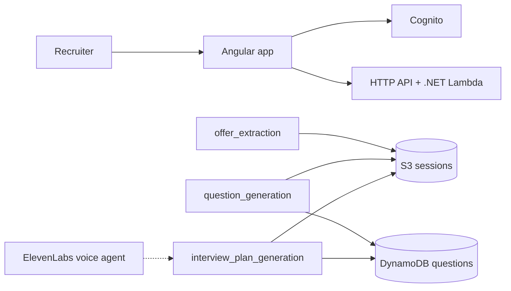

# Interview solution

Built during the Meta AI Developer Hackathon.

Mock interviews from a public job offer. A recruiter pastes an offer URL. Agents extract the role, generate a question bank, then curate a spoken interview plan. The web app and API sit in front of that pipeline.

Live:

- App: [https://hackathon-solution.com](https://hackathon-solution.com)
- API: [https://api.hackathon-solution.com](https://api.hackathon-solution.com)
- Auth: [https://auth.hackathon-solution.com](https://auth.hackathon-solution.com)

AWS region is **eu-central-1**.

## How it fits together



Preparation is three AgentCore harnesses, in this order:

1. **offer_extraction** opens the offer URL with the managed browser (then Decodo MCP `scrape_as_markdown` if the page is blocked, then Decodo `chatgpt` with web search if scrape fails) and writes `{user_id}/{session_id}/offer/details.json`.
2. **question_generation** reads that file and writes question items to DynamoDB.
3. **interview_plan_generation** curates 10–12 questions into `{user_id}/{session_id}/plan.json`.

`POST /api/interview-sessions` writes the session as `STARTED` and starts the Step Functions planner. Status then moves through `READING_OFFER`, `GENERATING_QUESTIONS`, `GENERATING_PLAN`, and ends at `SUCCESS`, `FAILED`, or `OFFER_NOT_REACHABLE` when extract does not write a real `offer/details.json`. After the plan is written, Step Functions invokes `seed-interview-progress` to fill the live-interview progress table from `plan.json`; agents do not write that table.

Live interview: the app opens `/interviews/:sessionId/play`, fetches a ConvAI signed URL (`GET /api/voice-agent/signed-url?purpose=interview|walkthrough`) and offer voice context, then connects with `@elevenlabs/client`. Session status becomes `IN_PROGRESS`. Interactive exercises pause the ConvAI session locally (no end-conversation) after the intro; submit reconnects the walkthrough agent, then `finish_solution_walkthrough` returns to the main interviewer. Ending via `POST /api/voice-agent/end-conversation` sets `COMPLETED` only when the progress queue is empty. Retake (`POST /api/interview-sessions/{sessionId}/retake`) re-seeds the progress queue from `plan.json`, resets interactive tasks to `NotAsked`, sets `SUCCESS`, and reuses the same session id.

During the call, ElevenLabs calls MCP `get_next_question` on `https://api.hackathon-solution.com/mcp/interview-questions/agent` (public Streamable HTTP; set ElevenLabs transport to **STREAMABLE_HTTP**, not SSE) to pop the next questions from that progress queue.

## Repository

| Path | What it is |
| --- | --- |
| `Frontend/` | Angular 20 app, Cognito OIDC, CloudFront + S3 |
| `Backend/` | .NET 10 API (`Hackathon.Api` on Lambda `dotnet10`) |
| `Infrastructure/` | Terraform for AWS |
| `Agents/AgentCore/` | AgentCore harness YAML + prompts. Terraform deploys every folder here |
| `Agents/ElevenLabsAgent/` | Main voice interviewer export (not Terraform) |
| `Agents/ElevenLabsAgent/WalkthroughAgent/` | Post-submit solution walkthrough agent (not Terraform) |
| `.github/workflows/` | Solution workflow: infra, then backend/frontend |

## AgentCore agents

Each folder under `Agents/AgentCore/` is one harness:

| Folder | Harness name | Writes |
| --- | --- | --- |
| `OfferExtractor` | `offer_extraction` | S3 `offer/details.json` |
| `QuestionGenerator` | `question_generation` | DynamoDB `hackathon-solution-interview-session-questions-table` |
| `InterviewPlanGenerator` | `interview_plan_generation` | S3 `plan.json` |

Changing anything under `Agents/AgentCore/` triggers the infrastructure workflow.

## Meta AI models

All reasoning that is not live speech goes through Meta models at `https://api.meta.ai/v1`.

**Muse Spark 1.3** (`openai/muse-spark-1.3` on AgentCore LiteLLM; `muse-spark-1.3` on Lambdas):

- Offer extraction, question generation, and interview plan generation (AgentCore harnesses)
- Describe visual interactive answers (diagram, schema, image, PDF) in `Hackathon.DescribeSolutionVision`
- Judge text and visual interactive answers, compose the interview overview, and review camera tape (stills, or video via Meta Files) in `Hackathon.BuildInterviewOverview`

**Muse Wonder 1.0** (`openai/muse-wonder-1.0` / `muse-wonder-1.0`):

- Judge coding interactive answers (`answer.zip`) in overview
- `CodeSolutionJudge` AgentCore harness when a code solution is scored that way

Live voice stays on ElevenLabs ConvAI. The interviewer and walkthrough agents use Meta **Muse Spark 1.2** as their custom LLM (`https://api.meta.ai/v1`, chat completions) so spoken turns also run on Meta models.

The Lambda path uses GitHub `META_MODEL_API_KEY` (`TF_VAR_meta_model_api_key`). AgentCore harnesses use an AgentCore Identity API key ARN on each `agent.yaml`.

## Data

**S3** `hackathon-solution-interview-sessions-bucket`

- `{user_id}/{session_id}/offer/details.json`
- `{user_id}/{session_id}/plan.json`

**DynamoDB**

- `hackathon-solution-interview-sessions-table` — `user_id` + `session_id`, attribute `status`
- `hackathon-solution-interview-session-questions-table` — `session_id` + `question_id`, GSI `module-index`
- `hackathon-solution-pending-interview-tasks-table` — `session_id` + `task_id` (interactive exercises; status `NotAsked`/`InProgress`/`Answered`)
- `hackathon-solution-interview-sessions-progress-table` — `session_id` + `question_id`, GSI `order-key-index` (runtime, not agents; optional `task_id` for interactive)

Interview modules: `Communication`, `TechnicalKnowledge`, `PracticalSkills`, `ArchitectureAndDesign`, `ProblemSolving`, `ExperienceValidation`, `DomainKnowledge`, `Behavioral`, `ForeignLanguage`.

## Local development

### Frontend

Create `Frontend/.env`:

```
COGNITO_AUTHORITY=https://cognito-idp.eu-central-1.amazonaws.com/<user-pool-id>
COGNITO_CLIENT_ID=<app-client-id>
```

```bash
cd Frontend
npm ci
npm start
```

App: [http://localhost:4200](http://localhost:4200). CORS already allows that origin.

### API

```bash
cd Backend
dotnet run --project Hackathon.Api
```

JWT and CORS in Lambda come from SSM under `/hackathon-solution/hackathon/`. Locally they come from `Hackathon.Api/appsettings.json` / user secrets. Handler: `Hackathon.Api::Hackathon.Api.LambdaEntryPoint::FunctionHandlerAsync`.

### Infrastructure

```bash
cd Infrastructure
terraform init -backend-config=env/hackathon.tfbackend
terraform plan
```

Settings: `Infrastructure/env/hackathon.yml`. AWS provider must be **>= 6.64**.

## CI

Push or PR on `main` runs `.github/workflows/solution.yml`. Path filters:

- `Infrastructure/` or `Agents/AgentCore/` → Terraform plan (apply on non-PR)
- `Backend/` → `dotnet lambda package` (deploy `hackathon-solution-api-hackathon` on non-PR)
- `Frontend/` → `npm run build` (sync hosting bucket + CloudFront invalidation on non-PR)

Secrets: `AWS_ACCESS_KEY`, `AWS_SECRET_KEY`, `COGNITO_AUTHORITY`, `COGNITO_CLIENT_ID`, `ELEVEN_LABS_API_KEY`.
