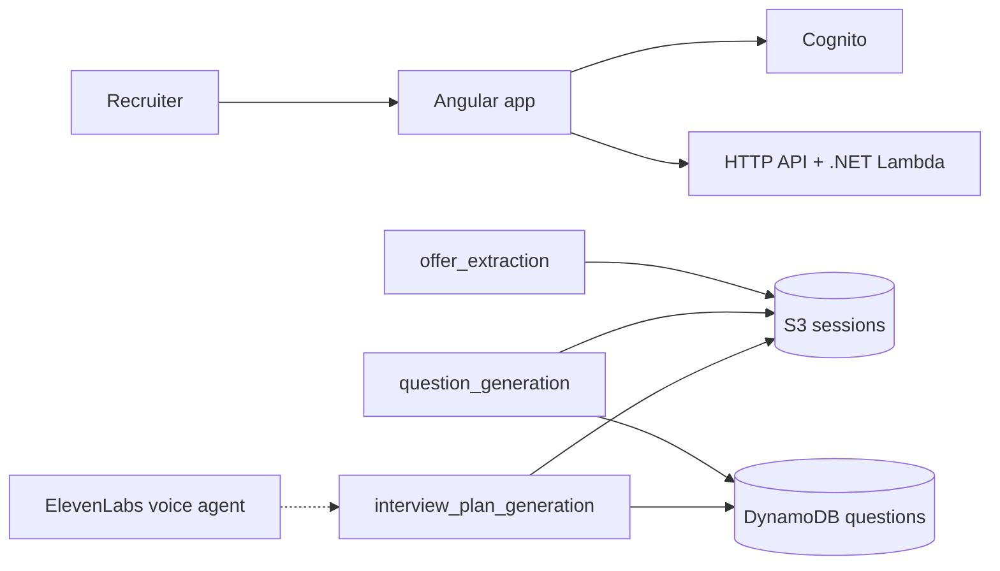

# Interview solution

Mock interviews from a public job offer. A recruiter pastes an offer URL. Agents extract the role, generate a question bank, then curate a spoken interview plan. The web app and API sit in front of that pipeline.

Live:

- App: [https://hackathon-solution.com](https://hackathon-solution.com)
- API: [https://api.hackathon-solution.com](https://api.hackathon-solution.com)
- Auth: [https://auth.hackathon-solution.com](https://auth.hackathon-solution.com)

AWS region is **eu-central-1**.

## How it fits together



Preparation is three AgentCore harnesses, in this order:

1. **offer_extraction** opens the offer URL with the managed browser and writes `{user_id}/{session_id}/offer/details.json`.
2. **question_generation** reads that file and writes question items to DynamoDB.
3. **interview_plan_generation** curates 10–12 questions into `{user_id}/{session_id}/plan.json`.

`POST /api/interview-sessions` writes the session as `STARTED` and starts the Step Functions planner. Status then moves through `READING_OFFER`, `GENERATING_QUESTIONS`, `GENERATING_PLAN`, and ends at `SUCCESS` or `FAILED`. Live-interview progress is a separate DynamoDB table; agents do not fill it.

## Repository

| Path | What it is |
| --- | --- |
| `Frontend/` | Angular 20 app, Cognito OIDC, CloudFront + S3 |
| `Backend/` | .NET 10 API (`Hackathon.Api` on Lambda `dotnet10`) |
| `Infrastructure/` | Terraform for AWS |
| `Agents/AgentCore/` | AgentCore harness YAML + prompts. Terraform deploys every folder here |
| `Agents/ElevenLabsAgent/` | Voice interviewer export (not Terraform) |
| `.github/workflows/` | Solution workflow: infra, then backend/frontend |

## AgentCore agents

Each folder under `Agents/AgentCore/` is one harness:

| Folder | Harness name | Writes |
| --- | --- | --- |
| `OfferExtractor` | `offer_extraction` | S3 `offer/details.json` |
| `QuestionGenerator` | `question_generation` | DynamoDB `hackathon-solution-interview-session-questions-table` |
| `InterviewPlanGenerator` | `interview_plan_generation` | S3 `plan.json` |

Models go through AgentCore LiteLLM (`openai/muse-spark-1.3`, `https://api.meta.ai/v1`) and an AgentCore Identity API key. Changing anything under `Agents/AgentCore/` triggers the infrastructure workflow.

## Data

**S3** `hackathon-solution-interview-sessions-bucket`

- `{user_id}/{session_id}/offer/details.json`
- `{user_id}/{session_id}/plan.json`

**DynamoDB**

- `hackathon-solution-interview-sessions-table` — `user_id` + `session_id`, attribute `status`
- `hackathon-solution-interview-session-questions-table` — `session_id` + `question_id`, GSI `module-index`
- `hackathon-solution-interview-sessions-progress-table` — `session_id` + `question_id`, GSI `order-key-index` (runtime, not agents)

Interview modules: `Communication`, `TechnicalKnowledge`, `PracticalSkills`, `ArchitectureAndDesign`, `ProblemSolving`, `ExperienceValidation`, `DomainKnowledge`, `Behavioral`, `ForeignLanguage`.

## Local development

### Frontend

Create `Frontend/.env`:

```
COGNITO_AUTHORITY=https://cognito-idp.eu-central-1.amazonaws.com/<user-pool-id>
COGNITO_CLIENT_ID=<app-client-id>
```

```bash
cd Frontend
npm ci
npm start
```

App: [http://localhost:4200](http://localhost:4200). CORS already allows that origin.

### API

```bash
cd Backend
dotnet run --project Hackathon.Api
```

JWT and CORS in Lambda come from SSM under `/hackathon-solution/hackathon/`. Locally they come from `Hackathon.Api/appsettings.json` / user secrets. Handler: `Hackathon.Api::Hackathon.Api.LambdaEntryPoint::FunctionHandlerAsync`.

### Infrastructure

```bash
cd Infrastructure
terraform init -backend-config=env/hackathon.tfbackend
terraform plan
```

Settings: `Infrastructure/env/hackathon.yml`. AWS provider must be **>= 6.64**.

## CI

Push or PR on `main` runs `.github/workflows/solution.yml`. Path filters:

- `Infrastructure/` or `Agents/AgentCore/` → Terraform plan (apply on non-PR)
- `Backend/` → `dotnet lambda package` (deploy `hackathon-solution-api-hackathon` on non-PR)
- `Frontend/` → `npm run build` (sync hosting bucket + CloudFront invalidation on non-PR)

Secrets: `AWS_ACCESS_KEY`, `AWS_SECRET_KEY`, `COGNITO_AUTHORITY`, `COGNITO_CLIENT_ID`.
